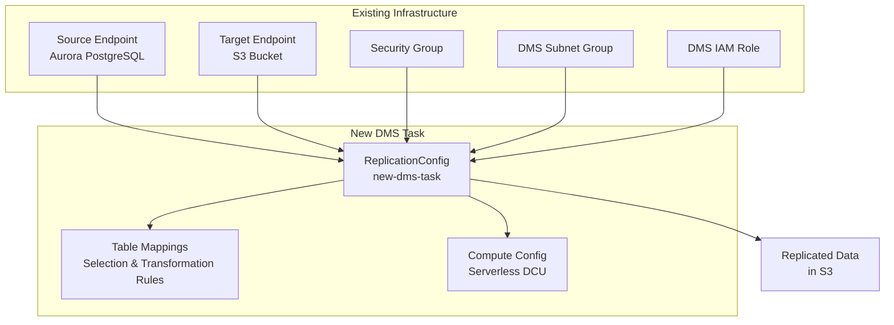

# Design Document: New DMS Task Replication

## Overview

This design implements a new AWS DMS serverless replication task that leverages existing source and target endpoints from the current infrastructure. The solution follows the established patterns in the codebase while providing flexibility for different table mappings and replication scenarios.

The new DMS task will be implemented as a separate CloudFormation template that references existing endpoints through cross-stack imports, enabling independent lifecycle management while maintaining consistency with the existing DMS infrastructure.

## Architecture

### High-Level Architecture



### Component Integration

The new DMS task integrates with existing infrastructure components:

1. **Endpoint Reuse**: References existing source and target endpoints by ARN
2. **Network Integration**: Uses existing DMS subnet group and security group
3. **Security Integration**: Leverages existing IAM roles and KMS encryption
4. **Monitoring Integration**: Inherits logging and monitoring configurations

## Components and Interfaces

### CloudFormation Template Structure

**Template Name**: `onedata-exchange-resources-core-DMS-task.yml`

**Key Components**:
- AWS::DMS::ReplicationConfig resource
- Parameter definitions for environment-specific configuration
- Cross-stack references to existing endpoints and networking
- Output exports for potential future integrations

### Parameter Interface

```yaml
Parameters:
  Environment:
    Type: String
    Description: Environment identifier (dev, tst, pst, prd)
  
  Account:
    Type: String
    Description: AWS Account ID for the deployment
  
  OnedataAccount:
    Type: String
    Description: Onedata AWS Account ID for cross-account references
  
  MinDCU:
    Type: Number
    Description: Minimum Data Capacity Units for serverless scaling
  
  MaxDCU:
    Type: Number
    Description: Maximum Data Capacity Units for serverless scaling
  
  DMSSubnetGroup:
    Type: String
    Description: DMS Subnet Group ID for networking configuration
  
  SecurityGroupID:
    Type: String
    Description: Security Group ID for DMS task networking (legacy parameter for compatibility)
```

### Cross-Stack Integration

The design leverages CloudFormation cross-stack references:

```yaml
SourceEndpointArn: 
  Fn::ImportValue: !Sub 'onedata-exchange-resources-core-DMS-components-${Environment}:OnedataExchangeDMSSourceEndpointARN'
TargetEndpointArn: 
  Fn::ImportValue: !Sub 'onedata-exchange-resources-core-DMS-components-${Environment}:OnedataExchangeDMSTargetEndpoint'
VpcSecurityGroupIds: 
  - Fn::ImportValue: !Sub 'onedata-exchange-resources-core-DMS-components-${Environment}:OnedataExchangeDMSSecurityGroup'
```

## Data Models

### Table Structure and Partitioning

The following tables are candidates for replication with their respective partition counts and volumes:

| Table Name | Partitions | Volume | Boundary Calculation |
|------------|------------|--------|---------------------|
| pxa_batch_tac | 6 | 115,447,252 | ~19,000,000 per partition |
| pxa_business_event_outbox | 0 | 1,474,576 | No partitioning needed |
| pxa_conversations_read_ref | 0 | 148,978,405 | No partitioning needed |
| pxa_correspondences | 0 | 21,296 | No partitioning needed |
| pxa_document_counterpart | 8 | 49,845,527 | ~6,000,000 per partition |
| pxa_ext_event_sub_mapping | 8 | 865,358,587 | ~108,000,000 per partition |
| pxa_external_business_event | 12 | 612,307,449 | ~51,000,000 per partition |
| pxa_line_items_changelog | 8 | 224,482,568 | ~28,000,000 per partition |
| pxa_lodgement_billing_event | 8 | 412,542,965 | ~52,000,000 per partition |
| pxa_residual_configs | 0 | 4,196 | No partitioning needed |
| pxa_residuals | 0 | 501,198 | No partitioning needed |
| pxa_simultaneous_workspaces | 0 | 691,906 | No partitioning needed |
| pxa_simultaneous_lodgements | 0 | 309,218 | No partitioning needed |
| pxa_subscriber_correspondence | 0 | 60,573 | No partitioning needed |

**Parallel Loading Strategy**: Tables with partitions > 0 will use range-based parallel loading with boundaries calculated by dividing the total volume by the number of partitions, rounded to the nearest million. This ensures optimal performance for large table replication.

### Table Mappings Structure

The table mappings follow the established JSON structure with two rule types:

1. **Selection Rules**: Define which tables to include in replication
2. **Table Settings Rules**: Configure parallel loading for large tables

Note: Transformation rules are not required for this implementation.

### Selection Rule Model

```json
{
  "rule-type": "selection",
  "rule-action": "include",
  "rule-id": "string",
  "rule-name": "string",
  "object-locator": {
    "schema-name": "string",
    "table-name": "string"
  },
  "filters": []
}
```

### Compute Configuration Model

```yaml
ComputeConfig:
  MultiAZ: boolean
  MinCapacityUnits: number
  MaxCapacityUnits: number
  PreferredMaintenanceWindow: string
  ReplicationSubnetGroupId: string
  VpcSecurityGroupIds: [string]
```

## Correctness Properties

*A property is a characteristic or behavior that should hold true across all valid executions of a system-essentially, a formal statement about what the system should do. Properties serve as the bridge between human-readable specifications and machine-verifiable correctness guarantees.*

### Property 1: Endpoint ARN References
*For any* DMS ReplicationConfig template, all endpoint references should use valid ARN format and point to existing source and target endpoints from the components stack
**Validates: Requirements 1.1, 1.2, 1.5**

### Property 2: Table Mapping Structure Validation
*For any* table mappings configuration, all selection rules should include valid schema names, table names, and follow the established rule structure format
**Validates: Requirements 2.1, 2.4, 2.5**

### Property 3: Transformation Rules Validation
*For any* transformation rules in table mappings, they should include proper rule targets, actions, and data type specifications for column operations
**Validates: Requirements 2.2**

### Property 4: Parallel Loading Configuration
*For any* table settings rules with parallel loading, they should specify valid column names and boundary ranges for large table processing
**Validates: Requirements 2.3**

### Property 5: Compute Configuration Validation
*For any* DMS ReplicationConfig compute settings, they should include valid DCU parameters, Multi-AZ configuration, and maintenance window settings
**Validates: Requirements 3.1, 3.2, 3.3**

### Property 6: Network Configuration References
*For any* DMS ReplicationConfig networking configuration, it should reference existing subnet groups and security groups through proper cross-stack imports
**Validates: Requirements 3.4**

### Property 7: Encryption Configuration
*For any* DMS ReplicationConfig with encryption enabled, it should include valid KMS key references for data protection
**Validates: Requirements 3.5, 6.2**

### Property 8: Replication Type and Settings
*For any* DMS ReplicationConfig, it should specify "full-load-and-cdc" replication type with proper full load and CDC settings
**Validates: Requirements 4.1, 4.2, 4.3, 4.4, 4.5**

### Property 9: CloudFormation Template Structure
*For any* DMS task CloudFormation template, it should include required parameters, proper resource definitions, and valid outputs with export names
**Validates: Requirements 5.1, 5.2, 5.4**

### Property 10: Resource Tagging and Naming
*For any* DMS task resources, they should include environment and team tags, and follow established naming convention patterns
**Validates: Requirements 5.3, 5.5**

### Property 11: Security Configuration Compliance
*For any* DMS ReplicationConfig security settings, they should use existing IAM roles, Secrets Manager for credentials, and SSL encryption for database connections
**Validates: Requirements 6.1, 6.3, 6.4, 6.5**

### Property 12: S3 Target Configuration
*For any* S3 target endpoint settings, they should specify CSV format with pipe delimiters, GZIP compression, column names, timestamp columns, and proper folder structure
**Validates: Requirements 7.1, 7.2, 7.3, 7.4, 7.5**

<function_calls>
<invoke name="prework">
<parameter name="featureName">new-dms-task-replication

## Error Handling

### CloudFormation Deployment Errors

**Parameter Validation Errors**:
- Invalid DCU values (outside supported range)
- Missing or invalid environment parameters
- Invalid task identifier format

**Cross-Stack Reference Errors**:
- Missing or invalid endpoint ARNs
- Unavailable security group or subnet group references
- KMS key access permission issues

**Resource Creation Errors**:
- DMS service limits exceeded
- Insufficient IAM permissions for DMS operations
- Network connectivity issues between subnets

### Runtime Replication Errors

**Source Database Connectivity**:
- Database connection failures due to network issues
- Authentication failures with Secrets Manager
- SSL/TLS certificate validation errors

**Target S3 Connectivity**:
- S3 bucket access permission errors
- KMS encryption key access issues
- S3 service availability problems

**Data Replication Errors**:
- Table schema changes during replication
- Data type conversion errors
- LOB data size exceeding configured limits

### Error Recovery Strategies

1. **Automatic Retry**: DMS automatically retries transient errors with exponential backoff
2. **Error Logging**: All errors are logged to CloudWatch for monitoring and alerting
3. **Manual Intervention**: Critical errors require manual investigation and resolution
4. **Rollback Capability**: CloudFormation stack rollback for deployment failures

## Testing Strategy

### Dual Testing Approach

The testing strategy employs both unit tests and property-based tests to ensure comprehensive coverage:

- **Unit tests**: Verify specific examples, edge cases, and error conditions
- **Property tests**: Verify universal properties across all inputs
- Together they provide comprehensive coverage where unit tests catch concrete bugs and property tests verify general correctness

### Unit Testing

**CloudFormation Template Validation**:
- Template syntax validation using AWS CLI or cfn-lint
- Parameter validation with various input combinations
- Cross-stack reference validation in isolated test environments

**Configuration Testing**:
- Table mappings JSON structure validation
- Endpoint ARN format validation
- Resource naming convention compliance

**Integration Testing**:
- End-to-end deployment testing in development environment
- Cross-stack integration validation
- Network connectivity testing between components

### Property-Based Testing

Property-based tests will be implemented using AWS CloudFormation testing frameworks and custom validation scripts. Each test will run a minimum of 100 iterations to ensure comprehensive coverage.

**Template Property Tests**:
- **Feature: new-dms-task-replication, Property 1**: Endpoint ARN references validation
- **Feature: new-dms-task-replication, Property 2**: Table mapping structure validation
- **Feature: new-dms-task-replication, Property 9**: CloudFormation template structure validation

**Configuration Property Tests**:
- **Feature: new-dms-task-replication, Property 5**: Compute configuration validation
- **Feature: new-dms-task-replication, Property 8**: Replication settings validation
- **Feature: new-dms-task-replication, Property 12**: S3 target configuration validation

**Security Property Tests**:
- **Feature: new-dms-task-replication, Property 7**: Encryption configuration validation
- **Feature: new-dms-task-replication, Property 11**: Security configuration compliance

### Testing Tools and Frameworks

**CloudFormation Testing**:
- AWS CloudFormation Linter (cfn-lint) for template validation
- AWS CLI for deployment testing
- Custom Python scripts for property-based validation

**Infrastructure Testing**:
- AWS Config Rules for compliance validation
- CloudWatch monitoring for runtime validation
- AWS Systems Manager for configuration management testing

### Test Environment Strategy

**Development Environment**:
- Full deployment testing with sample data
- Performance testing with various DCU configurations
- Error injection testing for resilience validation

**Staging Environment**:
- Production-like testing with realistic data volumes
- Cross-stack integration validation
- Security compliance testing

**Production Environment**:
- Monitoring and alerting validation
- Performance metrics collection
- Disaster recovery testing