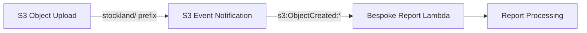

# Design Document: Stockland S3 Event Notification

## Overview

This feature adds an S3 event notification entry for the `stockland/` prefix to the existing `onedata-bespokereporting-resources-s3.yml` CloudFormation template. The change is a single additional `LambdaConfigurations` list item in the `NotificationConfiguration` of the `BespokeReportingS3` bucket resource.

The implementation follows the identical pattern already established for `anz/`, `cba/`, `westpac/`, and `nab/` prefixes — triggering the same Lambda function (`onedata-bespoke-s3-extract-lambda`) on `s3:ObjectCreated:*` events filtered by prefix.

No new resources, parameters, or outputs are required.

## Architecture

The architecture remains unchanged. The existing event-driven pattern is:



The `BespokeReportingS3` bucket already has notification configurations for four prefixes. This change appends a fifth entry to the same `LambdaConfigurations` list.

### Design Decisions

1. **Append to existing list** — The new notification is added as the last entry in `LambdaConfigurations` to maintain readability and minimize diff noise.
2. **Identical structure** — No deviations from the existing pattern. Same `Event`, `Function`, and `Filter` structure.
3. **No new parameters** — The Lambda ARN is resolved via the existing cross-stack export, which is environment-agnostic.

## Components and Interfaces

### Modified Resource: `BespokeReportingS3`

The only change is within the `NotificationConfiguration.LambdaConfigurations` array of the `BespokeReportingS3` S3 bucket resource.

New entry to append:

```yaml
- Event: s3:ObjectCreated:*
  Function:
    Fn::Sub:
      - '${LambdaFunctionName}'
      - LambdaFunctionName: !ImportValue
          'Fn::Sub': "onedata-bespokereporting-resources-lambda-${Environment}:BespokeReportLambdaArn"
  Filter:
    S3Key:
      Rules:
        - Name: prefix
          Value: stockland/
```

### Unchanged Components

- `BespokereportingBucketPolicy` — no policy changes needed
- `BespokereportingKMSKey` — no encryption changes
- All existing Lambda configurations for `anz/`, `cba/`, `westpac/`, `nab/`
- All outputs and exports

## Data Models

No new data models. The S3 event notification uses the standard AWS S3 event structure (`s3:ObjectCreated:*`), which the existing Lambda already handles. Files placed under `stockland/` will be processed by the same Lambda code path that handles other prefix-based reports.


## Correctness Properties

*A property is a characteristic or behavior that should hold true across all valid executions of a system — essentially, a formal statement about what the system should do. Properties serve as the bridge between human-readable specifications and machine-verifiable correctness guarantees.*

### Property 1: Stockland notification structural consistency

*For any* valid rendered version of the CloudFormation template, the `LambdaConfigurations` list must contain an entry with `Event: s3:ObjectCreated:*`, a `Filter` with `S3Key.Rules` containing `Name: prefix, Value: stockland/`, and a `Function` that resolves the Lambda ARN via `ImportValue` of the cross-stack export `onedata-bespokereporting-resources-lambda-{Environment}:BespokeReportLambdaArn` — and this entry must be structurally identical to the existing `anz/` entry (differing only in the prefix value).

**Validates: Requirements 1.1, 1.2, 1.3, 1.4, 2.1, 2.2**

### Property 2: No new parameters introduced

*For any* version of the modified template, the `Parameters` section must contain exactly the same keys as before the change (`Environment` and `Account` only), ensuring deployability across all environments without additional configuration.

**Validates: Requirements 2.3**

### Property 3: Existing notifications preserved

*For any* version of the modified template, all four original `LambdaConfigurations` entries (`anz/`, `cba/`, `westpac/`, `nab/`) must remain present and structurally unmodified, and all non-notification properties of the `BespokeReportingS3` resource (encryption, lifecycle, access control) must be unchanged.

**Validates: Requirements 3.1, 3.2**

## Error Handling

This change does not introduce new error handling logic. The existing Lambda function already handles S3 event processing for prefix-based notifications. If the Lambda fails to process a stockland/ file, the existing error handling and retry behaviour applies (standard S3-to-Lambda invocation retries).

Potential deployment errors:
- **Invalid YAML syntax** — caught by CloudFormation validation before deployment
- **Missing cross-stack export** — the Lambda stack must be deployed first (existing dependency, no change)
- **Duplicate prefix filter** — CloudFormation will reject duplicate notification configurations for the same prefix

## Testing Strategy

### Template Validation (Unit-level)

1. **YAML lint** — validate the modified template is syntactically correct YAML
2. **CloudFormation validate-template** — run `aws cloudformation validate-template` against the modified file
3. **Structural assertion** — parse the YAML and assert:
   - `LambdaConfigurations` has exactly 5 entries
   - The 5th entry has prefix `stockland/`
   - All entries share the same `Event` and `Function` structure

### Property-Based Testing

Library: **Hypothesis** (Python) or **cfn-lint** rules for structural validation.

Each property test should run a minimum of 100 iterations where randomisation applies (e.g., generating environment names to validate template rendering).

- **Feature: stockland-s3-event, Property 1: Stockland notification structural consistency** — Parse template, extract LambdaConfigurations, validate the stockland entry matches the schema of existing entries.
- **Feature: stockland-s3-event, Property 2: No new parameters introduced** — Parse template, assert Parameters section contains only `Environment` and `Account`.
- **Feature: stockland-s3-event, Property 3: Existing notifications preserved** — Parse original and modified templates, assert the first four LambdaConfigurations entries are byte-identical, and non-notification properties match.

### Integration Testing

- Deploy the modified stack to the `dev` environment
- Upload a test file to `stockland/` prefix
- Verify the Lambda is invoked via CloudWatch Logs
- Verify existing prefixes (`anz/`, `cba/`, `westpac/`, `nab/`) still trigger correctly

### Deployment Verification

- Deploy to `dev` → `tst` → `pst` → `prd` following existing CI/CD pipeline
- No rollback expected since the change is additive and non-breaking
