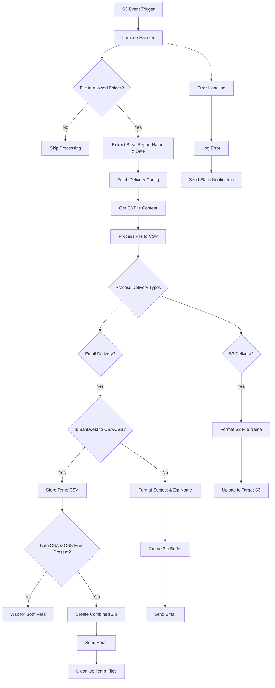

# Bespoke Report Extract Lambda Flow Diagram

_This was generated by AI Amazon Q Developer_

## Key Components

1. **Trigger**: S3 event when a file is uploaded to specific folders
2. **File Processing**:
   - Validates file is in allowed folders
   - Extracts report name and date from filename
   - Fetches delivery configuration from parameter file
   - Processes file content to CSV format

3. **Delivery Types**:
   - **Email Delivery**:
     - Special handling for Bankwest to CBA/CBB reports (waits for both files)
     - Creates password-protected zip files when configured
     - Formats subject and filename based on report type rules

   - **S3 Delivery**:
     - Uploads to target S3 bucket with formatted filename
     - Applies appropriate permissions

4. **Error Handling**:
   - Logs errors
   - Sends notifications to Slack

## Function Dependencies

- **AWS Services**: S3, Secrets Manager
- **External Services**: SMTP (Office 365), Slack (for notifications)
- **Key Helper Functions**:
  - `process_file_to_csv`: Converts file content to CSV format
  - `create_multi_file_zip_buffer`: Creates zip archives (with optional password)
  - `send_email`: Handles email delivery
  - `handle_s3_delivery`: Manages S3 file uploads